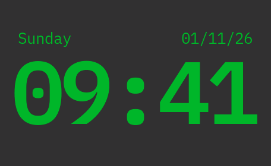
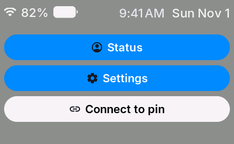
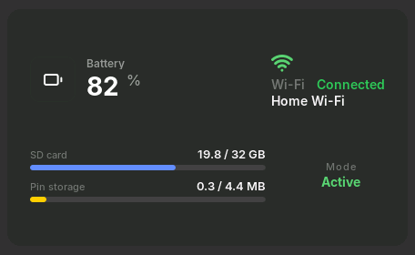
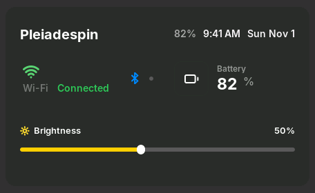

# The Pleiadesfolk Plurality Pin

This is the codebase for a wearable display pin for plural systems. It shows who is fronting as a name tag or a photo, keeps a front history, and stays in sync with [PluralKit](https://pluralkit.me).

The pin is configurable from a web dashboard, available on a phone over Wi-Fi. 

This project was largely coded with the help of Claude Opus 5.5. The UI was designed by Lyra Ellis in Figma and LVGL.

New to the pin? Start with the **[User guide](docs/USER_GUIDE.md)**.

## Introduction and design philosophy

This pin was made to solve a pretty specific problem that we had — that of the fact that we needed a way to register who was fronting to the people we are out as plural as. 

It uses a [Waveshare ESP32-C6-Touch-AMOLED-1.64](https://docs.waveshare.com/ESP32-C6-Touch-AMOLED-1.64), with a screen of 280 x 456 pixels. The UI is designed in a similar resolution as a result. If you wish to adopt the code here or fork this project to make your own, you will have to use this exact board. Fortunately, we think it's rather popular. 

The initial design philosophy was for a pin that also doubled as a grounding tool and switch tracker, but we realised that reconciling the switch history between PK and the pin can get iffy. 

As it is currently designed, the pin uses PluralKit as its primary source of truth on who's fronting in a system and relevant system data (names, display names, colours, etc.)

The pin is designed to read who your fronter is from PK. You can change that via `pk;switch`. 

We recommend adopting `pk;cfg proxy switch new` and `pk;ap front` as your autoproxy and proxy switch settings, in order to make the most out of this code base. `pk;ap latch` does not register switches.

This project won't be actively maintained; the code and the UI will only be tuned to the device that we are designing this for. 

Feel free to fork this project and write your own code! 

## What it does

- **Shows the current fronter** in one of three styles, chosen per member:
  - *Namecard*: text in the member's font and colour, with optional animated gradient text
  - *Image*: a photo, preferably in 280 x 456px 
  - *Image with name*: a photo beside a panel with a name that can be styled similar to the namecard.
- **Switching on the pin**: swipe left/right on the fronter, or press the side
  button (once: next member, twice: no fronter, three times or hold: clock).
  A switch is saved after 5 seconds with no more presses, so you can step past
  members without logging them. 
- **Front history**, kept on the pin, with "time fronting" charts in the dashboard. If connected to PluralKit, dashboard will also have PluralKit front history. 
- **PluralKit sync**:
  - import members, switches and avatars from a `pk;export` file
  - one-way polling of your current front (system ID or token)
  - instant updates through an optional self-hosted [relay](relay/README.md)
  - two-way history sync for the last day, choosing which side wins
- **Phone dashboard** at `http://<pin's address>/`: front, members, history,
  Wi-Fi and import, with an optional password.
- **Wi-Fi**: up to 6 saved networks, phone hotspots included; NTP clock. A
  new pin with no saved network starts its own setup Wi-Fi, so it can be set
  up from a phone.
- **Battery care**: battery log, a low-battery warning, then deep sleep
  below 3.40 V so the cell isn't run flat.

## Screenshots

| | |
|---|---|
|  |  |
| **Fronter** (namecard mode) | **Clock** |
|  |  |
| **Menu** (swipe down on the fronter) | **Status** |
|  | |
| **Settings** | |

*Rendered from the pin's screen code at its real 456×280 size, with example
values for the time, battery and Wi-Fi.*

## Hardware

| Part | Details |
|---|---|
| Board | [Waveshare ESP32-C6-Touch-AMOLED-1.64](https://docs.waveshare.com/ESP32-C6-Touch-AMOLED-1.64) |
| Chip | ESP32-C6 (single RISC-V core, 160 MHz, 512 KB RAM, 16 MB flash, no PSRAM) |
| Screen | 1.64" AMOLED, 280×456, CO5300 over QSPI; used in **landscape (456×280)** with software rotation |
| Touch | FocalTech (FT3168 driver), I²C |
| Battery | 3.7 V Li-ion on MX1.25 connector. Current hardware uses 600mAh, which approximates to 5 hours of battery life while display is always on. |
| Buttons | BOOT (GPIO9) is the pin's side button; PWR is hardware-only on/off |
| Optional | microSD card (photos), DIP switch JP8 pin 2 ON |
| Optional | An always-on Linux computer for a PluralKit relay (so as to not query PK all the time/have PK's API tell the pin to register a switch) |

## Repository layout

```
firmware/pin/            The pin's firmware (ESP-IDF 5.5 + LVGL 9.5)
  main/                  C sources, one module per job (see below)
  main/ui/               Generated UI code - rebuilt by tools/sync_ui.py, don't edit
  dashboard/index.html   The web dashboard (one file, plain JavaScript), built into the firmware
  assets/images.bin      UI images, flashed to the "assets" partition
  tools/sync_ui.py       Copies the LVGL Editor's output into the firmware
  partitions.csv         Flash layout
firmware/landscape_test/ Small test that proved the landscape display + touch setup
relay/                   PluralKit webhook relay (Python, systemd service) and its setup guide
test_project/ui/         LVGL Editor project (XML screens/components, fonts, images)
plurality-pin.fig        Figma design the UI came from
```

### Firmware modules (`firmware/pin/main/`)

| File | Job |
|---|---|
| `main.c` | Start-up, time zone, LVGL task |
| `display.c` | Screen + touch glue: rotation, swipe / tap / hold detection |
| `nav.c` | Moving between screens, the menu, switch mode, toasts |
| `boot.c` | Boot screen fade-in |
| `fronter.c` | Draws the current fronter (namecard / image / image with name) |
| `textpic.c` | Image decoder for namecard text pictures (streams from storage, near-zero RAM) |
| `photos.c` | Fast photo slots in the `photos` flash partition |
| `button.c` | Side button: taps, holds, delayed switch saving |
| `store.c` | Members, front history and pictures on the `storage` partition |
| `web.c` | Web server: dashboard and `/api/*` |
| `auth.c` | Dashboard password and login sessions |
| `wifi.c` | Saved networks, setup Wi-Fi, scanning, NTP |
| `pksync.c` | PluralKit sync (relay first, direct polling as fallback) |
| `status.c` / `power.c` | Battery, Wi-Fi and storage status; low-battery sleep |
| `brightness.c` / `settings.c` | Settings screen |
| `connect.c` | QR codes for the dashboard address and for joining the setup Wi-Fi |
| `storage_info.c` | SD card mount and storage gauges |
| `assets.c` | Memory-mapped UI images |

### Flash layout

| Partition | Size | Holds |
|---|---|---|
| `factory` | 5.3 MB | The app |
| `photos` | 4 MB | 8 "fast photo" slots, drawn straight from flash |
| `assets` | 2 MB | UI images |
| `storage` | 4.6 MB | FAT: members, front history, namecard pictures, battery log |

There's no OTA partition, so updates are by USB only.

## Building and flashing

You need [ESP-IDF v5.5](https://docs.espressif.com/projects/esp-idf/en/v5.5.2/esp32c6/get-started/index.html)
installed (`./install.sh esp32c6`).

1. **Wi-Fi for the first start (optional).** Copy
   `firmware/pin/main/wifi_credentials.example.h` to `wifi_credentials.h` in
   the same folder and fill in your network name and password. 
   It only seeds the first saved network: after that, manage
   networks in the dashboard. Without it the pin starts its own setup Wi-Fi
   instead (see [First-time Wi-Fi setup](#first-time-wi-fi-setup)).

2. **Time zone.** `TIME_ZONE` in `firmware/pin/main/main.c` is `"UTC"` by default. The pin will either ask PluralKit for the timezone, or you can set the timezone on the dashboard.
  
3. **Build and flash.** In each new terminal, load ESP-IDF first:

   ```bash
   . ~/esp/esp-idf/export.sh
   ```

   Then:

   ```bash
   cd firmware/pin
   ```

   ```bash
   idf.py build
   ```

   Find the board's USB port (it changes with the USB socket you use):

   ```bash
   ls /dev/cu.usbmodem*
   ```

   ```bash
   idf.py -p /dev/cu.usbmodem2101 flash monitor
   ```

   `flash` also writes the UI images to the `assets` partition. Press
   Ctrl+] to leave the monitor. Opening the serial port restarts the board.

Flashing the app keeps members, history and photos: they live in their own
partitions. `idf.py erase-flash` deletes everything.

### First-time Wi-Fi setup

A pin with no saved network (built without `wifi_credentials.h`, or after
every network was removed on the dashboard) starts its own Wi-Fi called
**Plurality Pin setup**. Its password is made at random once per pin and
shown on the pin's screen.

1. On the pin, swipe down on the fronter and open **Connect to pin**. It shows
   a QR code with the network's name and password beside it.
2. Scan the code with your phone's camera and tap **Join "Plurality Pin
   setup"**. A "No Internet Connection" warning is normal.
3. The pin then shows a second QR code. Scan it to open the dashboard (or type
   `192.168.4.1` in your browser). It opens on the Settings tab.
4. Tap **Find networks nearby**, pick your network, type its password, tap
   **Add**, then **Save to the pin**.
5. Once the pin has joined your network, the dashboard shows its new address.
   About 15 seconds later the setup Wi-Fi turns off and your phone goes back
   to its usual Wi-Fi. Open the dashboard again from the Connect screen.

If the password was wrong, the setup Wi-Fi stays on: join it again and fix it.

## Changing the UI

The screens are designed in Figma, exported with LVGL Figma Flow into
`test_project/ui/`, and turned into C by the LVGL Editor.

1. Open `test_project/ui/` in the LVGL Editor, make changes, press **Ctrl+B**.
2. From `firmware/pin`, run:

   ```bash
   python3 tools/sync_ui.py
   ```

   This copies the generated code into `main/ui/`, pre-renders every font
   size as a bitmap font, and packs the images into `assets/images.bin`. The
   first time, install the font converter it uses:

   ```bash
   cd tools && npm ci --cache /tmp/npm-cache
   ```

3. Build and flash as above.

Live values (time, battery, Wi-Fi and so on) are LVGL *subjects* declared at the
end of `test_project/ui/globals.xml` and set by the firmware. All XML files
are marked `OWNED_BY=USER`, so a new Figma export doesn't overwrite hand edits. 

## The PluralKit relay

PluralKit can't reach the pin directly, so for instant updates a small Python
program on an always-on computer receives PluralKit's webhook and passes the
front to the pin (long polling over your home network, or over the internet
through Tailscale Funnel). Without it, the pin checks PluralKit once a minute.
Setup: **[relay/README.md](relay/README.md)**.

## Privacy and security

- Your PluralKit token stays on the pin (and on the relay, if you use one).
  The dashboard never shows it again after saving.
- The dashboard is plain HTTP on your local network. Set a dashboard password
  (Settings tab) if you use shared networks. Holding the side button for 10
  seconds removes the password.
- The setup Wi-Fi uses WPA2 with a random password rather than being open,
  because the Wi-Fi passwords you type on the dashboard travel over it.
- Don't commit `wifi_credentials.h` or your `pk;export` file if you are Forking This Repo. 

## Known limits

- Wi-Fi is 2.4 GHz only.
- The setup Wi-Fi only starts when no network is saved. If the saved networks
  are all out of reach, there's no way to bring it back from the pin itself:
  flash with a `wifi_credentials.h` instead.
- On USB the battery reading shows the charger, so the battery level only
  updates while running on battery.
- The code doesn't use the board's Bluetooth functionality. 
