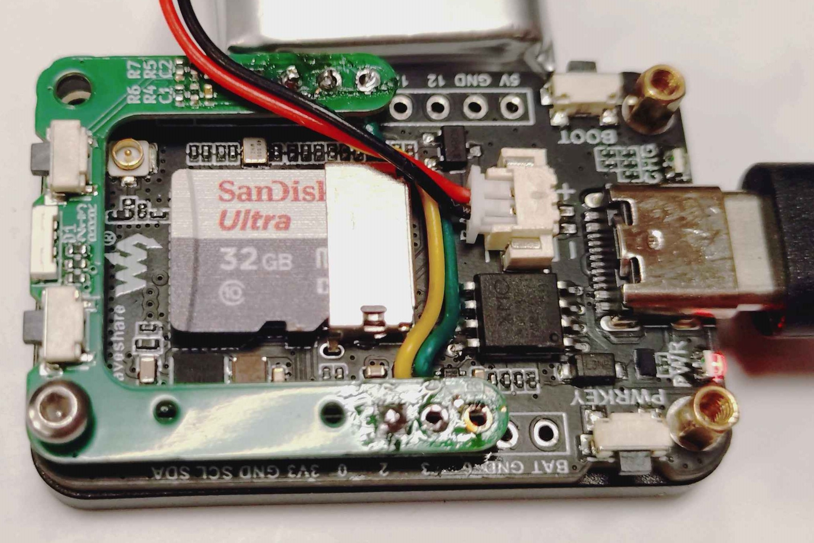
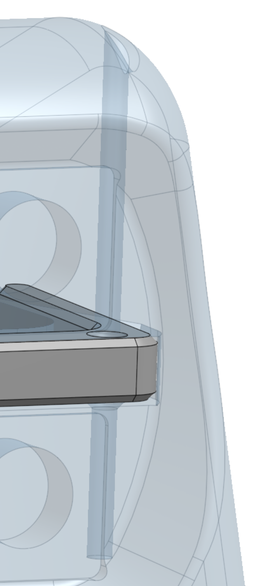

# Hardware

| Folder | What's in it |
| --- | --- |
| `electronics/` | The button daughterboard (`badgebuttonboard`): KiCad project, Gerbers, drill files, BOM and placement files for JLCPCB |
| `mechanical/` | The desk stand (base, lever, cable holder) and casing files as `.3mf`.  |

## Casing

Two versions of the case are available, one with buttons and one without. 
Recommended layer height is 0.2mm, with PLA supports if printed in PETG.
If printing with a transparent filament, please follow the settings at 
https://www.printables.com/model/15310-how-to-print-glass
One M2x5 and two M2x10 screws are required for assembly if you are using the 
button daughterboard, else three M2x5 screws are required. When securing the 
PCB assembly with the button daughterboard into the case, some tweaking of 
screw tightness may be required to ensure that the top button is able to 
actuate, and as a result the lower left corner might protrude a bit.

## Button daughterboard

Two buttons and an RGB LED, connected to the dev board by two connectors.
Green and blue aren't connected because the dev board has no free GPIOs left.
GPIO2, 3 and 6 are the only free pins once GPIO9 stays the BOOT button.

The button board is designed to be fabricated at JLCPCB with a 0.8mm thick
PCB, all other settings remaining as default. Select the option for PCB 
assembly, and use badgebuttonboard.csv and badgebuttonboard-all-pos.csv for 
BOM and part placement files respectively.

**GPIO23 can't be used**, although it's on header P2: the dev board wires it
to the display's tearing-effect output (`OLED_TE`, through the 0 Ω link R3),
which drives the line itself. Solder the board as shown in the image. 

With reference to the image, the top rightmost pin on the daughterboard should 
be soldered to GPIO6, with the pin to the left of it soldered to GPIO3. The
3V3, GND, and GPIO2 pins should be soldered with headers for mechanical support.

## Stand

All the stand parts are designed to print without support. The stand is designed 
to use four 8x3mm button magnets, but the cavity is 5mm deep to allow tuning of 
the magnet depth for magnets of different strength. Use superglue to secure the 
position of the magnet. The ejection lever is intended to be pinned into the 
stand with a length of 1.75mm filament, through the channel shown below.

